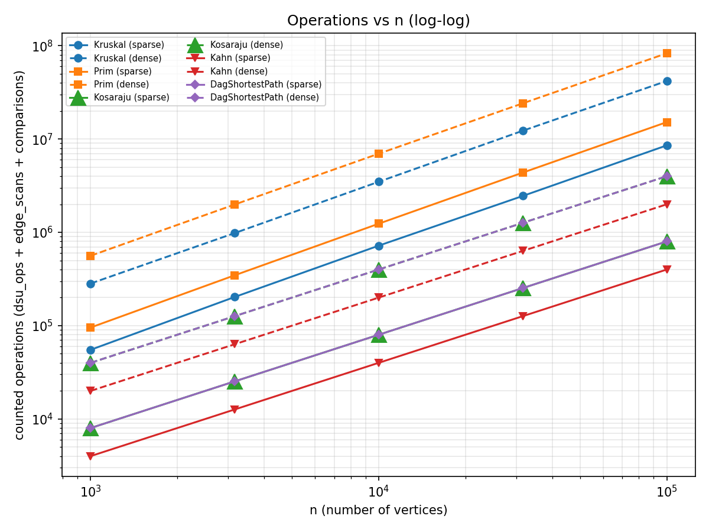
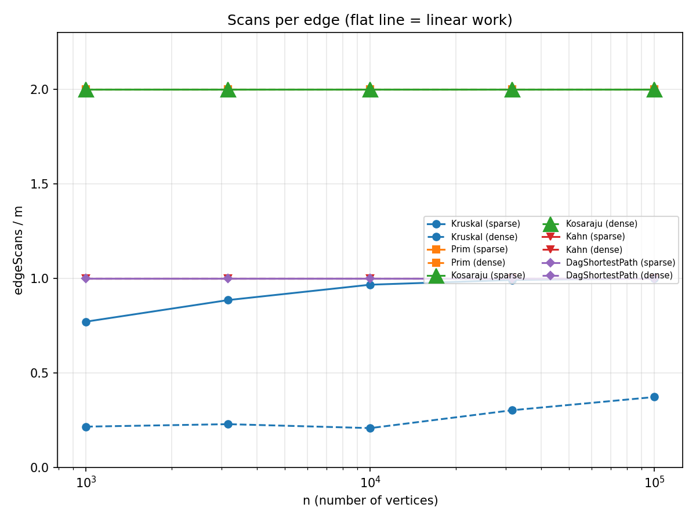
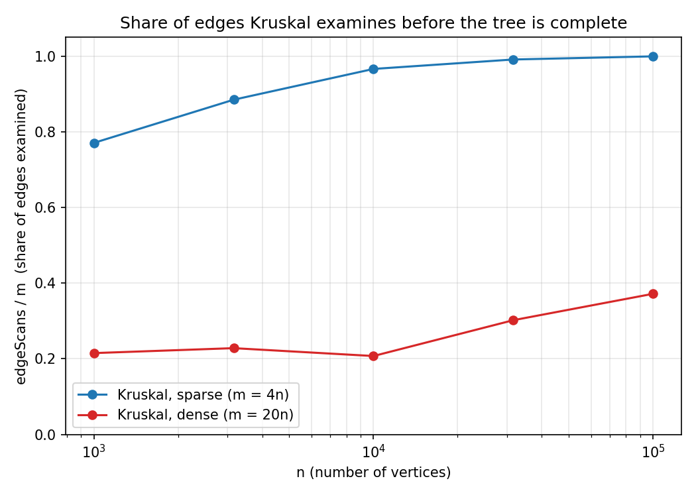

# Report — Assignment 3: Graphs (DSU, MST, SCC, Shortest Paths in DAGs)

**Name:** Nurasyl Zhambyl
**Group:** SE-2518
**GitHub repository:** https://github.com/nurasylzhambyl06-droid/daa-assignment3.git

All ten reference values of the assignment (MST weight, SCC count, sum of DAG distances) are reproduced exactly, and
the two exact scan counts hold on every graph: Kosaraju scans `2m` edges, Kahn and the DAG relaxation scan `m` each.
The benchmark checks all of this itself and fails loudly if anything differs.

## 1. Complexity Table

V = number of vertices, E = number of edges. "Extra space" is memory beyond the graph itself.

| Algorithm | Time | Extra space | Justification |
|---|---|---|---|
| DSU `find` / `union` | O(α(n)) amortized per operation | O(n) | Union by rank keeps every tree at most log n high and path compression flattens what `find` walks over; together the cost is the inverse Ackermann function, α(n) ≤ 4 for any realistic n. Arrays `parent[]`, `rank[]`. |
| Kruskal | O(E log E) = O(E log V) | O(E + V) | Sorting E edges dominates; the E DSU operations add only O(E·α(V)). Two `int[E]` index arrays for the merge sort, O(V) for the DSU. |
| Prim (lazy, PriorityQueue) | O(E log V) | O(E + V) | Every arc puts at most one entry into the queue and each push/poll costs O(log E) = O(log V); the queue can hold O(E) stale entries; `inTree[]` is O(V). |
| Kosaraju | Θ(V + E) | O(V + E) | Two DFS passes, each touches every vertex and every arc once; the reversed graph needs Θ(V + E); finish order and explicit stack are O(V). |
| Kahn | Θ(V + E) | O(V) | Every vertex enters the queue once, every arc is scanned once (when its start leaves the queue); in-degree array and queue are O(V). |
| DAG shortest paths | Θ(V + E) given the order | O(V) | One pass over the vertices in topological order relaxing every outgoing arc once; `dist[]` and `parent[]` are O(V). |
| *Tarjan (bonus)* | Θ(V + E) | O(V) | One DFS; `index[]`, `lowlink[]`, the active stack and the call stack are O(V); no reversed graph. |
| *Condensation + critical path (bonus)* | Θ(V + E) | O(V + E) | Builds one new graph, then Kahn and one relaxation pass. |

## 2. Counters vs Formulas

Every number below is a counter taken **inside** the algorithm divided by its complexity formula. If the complexity
class is right, the ratio must stay constant when n grows (the five sizes go up by a factor of √10 each, so n grows 100x).

| Algorithm: counter / formula | Density | n=1 000 | n=3 162 | n=10 000 | n=31 623 | n=100 000 |
|---|---|---|---|---|---|---|
| Kosaraju: edgeScans / (V+E) | sparse | 1.600 | 1.600 | 1.600 | 1.600 | 1.600 |
| | dense | 1.905 | 1.905 | 1.905 | 1.905 | 1.905 |
| Kahn: edgeScans / (V+E) | sparse | 0.800 | 0.800 | 0.800 | 0.800 | 0.800 |
| | dense | 0.952 | 0.952 | 0.952 | 0.952 | 0.952 |
| DAG shortest paths: edgeScans / (V+E) | sparse | 0.800 | 0.800 | 0.800 | 0.800 | 0.800 |
| | dense | 0.952 | 0.952 | 0.952 | 0.952 | 0.952 |
| Prim: edgeScans / E | both | 2.000 | 2.000 | 2.000 | 2.000 | 2.000 |
| Prim: comparisons / (E log₂ V) | sparse | 2.196 | 2.186 | 2.180 | 2.178 | 2.167 |
| | dense | 2.616 | 2.533 | 2.473 | 2.421 | 2.381 |
| Kruskal: comparisons / (E log₂ E) | sparse | 0.896 | 0.928 | 0.940 | 0.926 | 0.949 |
| | dense | 0.935 | 0.922 | 0.946 | 0.953 | 0.942 |
| Kruskal: dsuOps / E | sparse | 2.290 | 2.519 | 2.682 | 2.732 | 2.748 |
| | dense | 0.580 | 0.606 | 0.565 | 0.754 | 0.894 |
| Kruskal: dsuOps / edgeScans | sparse | 2.972 | 2.848 | 2.776 | 2.757 | 2.751 |
| | dense | 2.697 | 2.657 | 2.723 | 2.497 | 2.403 |

How to read it:

- **Traversals (Kosaraju, Kahn, DAG relaxation):** the ratio is constant to three decimals, and for a good reason: they
  scan every arc exactly once per pass, so `edgeScans / (V+E)` is exactly `2m/(n+m)` or `m/(n+m)`, i.e. 1.600 / 0.800 for
  m = 4n and 1.905 / 0.952 for m = 20n. Linear work Θ(V + E) is confirmed.
- **Prim:** each undirected edge is seen from both ends, so `edgeScans / E` is exactly 2. The queue work
  `comparisons / (E log₂ V)` stays in the narrow band 2.17 – 2.62 and drifts slowly down, which fits O(E log V).
- **Kruskal sort:** a merge sort uses E·log₂E − O(E) comparisons, so `comparisons / (E log₂ E)` is a constant just
  below 1 (0.90 – 0.95): the E log E term is confirmed.
- **Kruskal DSU:** `dsuOps` follows exactly from the code: 2 `find` calls for every examined edge plus 2 `find` calls and
  1 successful `union` for each of the n−1 accepted edges, i.e. `dsuOps = 2·edgeScans + 3·(n−1)` (check at
  n = 100 000, dense: 2·743 572 + 3·99 999 = 1 787 141, as measured). Per examined edge this is between 2.4 and 3.0 and can never exceed 3.
  So the cost of a DSU call does **not** grow with n — that is the "almost constant α(n)". `dsuOps / E` itself rises a
  little (2.29 → 2.75 sparse, 0.58 → 0.89 dense) only because Kruskal examines a larger share of the edges on bigger graphs (section 5).

## 3. Correctness Arguments

### Cut property — why Kruskal and Prim are correct

A cut splits the vertices into two non-empty parts S and V∖S. The claim: if e is a lightest edge crossing the cut,
then some minimum spanning tree contains e. Take any MST T; if e is not in T, adding e to T closes a cycle, and this
cycle has to cross the cut a second time through another tree edge f. Because e is a lightest crossing edge,
w(e) ≤ w(f), so T − f + e is again a spanning tree, no heavier than T, hence also minimum, and it contains e. Kruskal
uses this when it accepts an edge (u, v): the ends lie in different trees, so take S = the tree of u; every lighter edge
was already examined (accepted or rejected as a cycle), so no lighter edge leaves S, and (u, v) is a lightest edge across
that cut. Prim uses it directly: the cut is "tree built so far against everything else", the priority queue always
hands out a lightest crossing edge, and the skipped entries are edges with both ends in the tree, which do not cross the
cut at all. By induction the chosen edges always lie inside some MST, so when n−1 of them are chosen they are an MST.

### Induction on the topological order — why one pass of relaxations is enough in a DAG

Let v₁, …, vₙ be the topological order, so every edge leads from an earlier vertex to a later one, and let d(v) be the
true shortest distance from the virtual super-source (sources have d = 0). The claim is: when the pass reaches vᵢ,
dist[vᵢ] = d(vᵢ). Base: v₁ has no incoming edge (nothing stands before it), so it is a source and dist = 0 = d(v₁).
Step: assume the claim for v₁ … vᵢ₋₁. Either vᵢ is a source (done), or a shortest path to vᵢ ends with an edge (vⱼ, vᵢ)
with j < i. By the hypothesis dist[vⱼ] = d(vⱼ) when vⱼ was processed, and processing vⱼ relaxed the edge (vⱼ, vᵢ), so
dist[vᵢ] ≤ d(vⱼ) + w = d(vᵢ); on the other hand every stored value is the length of a real path, so dist[vᵢ] ≥ d(vᵢ).
Hence dist[vᵢ] = d(vᵢ) before vᵢ is processed, and a single pass in order is enough: nothing is ever improved after its turn.

### Why negative weights are safe in a DAG but not in a general graph

The argument above never used the sign of a weight, only the order, so negative edges change nothing. A DAG also has no
cycles, hence no negative cycle can exist. In a general graph a negative cycle can be walked around forever, so a
"shortest path" does not exist at all, and Dijkstra's rule "a vertex taken from the queue is final" breaks as soon as one
edge is negative. A general graph with negative edges needs Bellman-Ford (O(V·E)), which also detects negative cycles.
The tests compare the DAG algorithm against Bellman-Ford on 200 random DAGs with weights from −20 to 50.

## 4. Which Algorithm When

| Situation | Choice | Why |
|---|---|---|
| MST, **sparse** graph, edges come as a list | **Kruskal** | Needs only the edge list; sorting E edges is cheap when E is small; DSU makes the cycle check almost free. |
| MST, **dense** graph, adjacency list | **Kruskal or Prim** — measure with counters | With a binary-heap Prim, both are O(E log V). On my dense graphs Kruskal did about half of Prim's counted operations (42.0 M vs 83.1 M at n = 100 000), because it stops after n−1 accepted edges and examines only 21 – 37 % of them. The textbook advantage of Prim on dense graphs needs an adjacency **matrix** (O(V²), no sorting) or a Fibonacci heap. |
| MST on a graph that may be disconnected | Either; both return a forest | Kruskal simply runs out of edges; Prim restarts from every unvisited vertex. Both report the number of components. |
| Order of dependent jobs, **no cycle possible** | **Kahn** | Θ(V + E), and the same run proves there is no cycle. |
| Order of jobs, **cycle possible** (deadlock) | Kahn to detect, **SCC** to find the deadlock groups | An SCC with more than one vertex (or a self-loop) is a deadlock; the condensation of the SCCs is a DAG that can be ordered. |
| Find the deadlock groups / mutual reachability | **Kosaraju** (simple) or **Tarjan** (half the edge scans) | Both Θ(V + E); Tarjan scans each arc once instead of twice and needs no reversed graph. |
| Shortest paths, **DAG** (negative weights allowed) | **Relaxation in topological order** | One pass, Θ(V + E), the fastest possible. |
| Shortest paths, general graph, weights ≥ 0 | Dijkstra | O((V + E) log V). |
| Shortest paths, general graph, negative weights | Bellman-Ford | O(V·E); detects negative cycles. |
| Longest path / critical path | Condensation + relaxation with flipped signs | Easy only on a DAG. |
| Many "are a and b already connected?" queries while links keep being added | **DSU** | O(α(n)) per operation, no graph traversal. |
| Input is an edge list vs adjacency list | Edge list: Kruskal, DSU. Adjacency list: Prim, DFS, Kahn, relaxation | Traversals need the successors of a vertex; building adjacency lists from an edge list costs Θ(V + E). |

## 5. Slope Check

On log-log axes a straight line of slope 1 means linear work. Fitted slopes of the five sizes (n from 1 000 to 100 000):

| Algorithm | Density | Slope of edgeScans | Slope of all operations |
|---|---|---|---|
| Kosaraju | sparse / dense | **1.000** / **1.000** | 1.000 / 1.000 |
| Kahn | sparse / dense | **1.000** / **1.000** | 1.000 / 1.000 |
| DAG shortest paths | sparse / dense | **1.000** / **1.000** | 1.000 / 1.000 |
| Prim | sparse / dense | 1.000 / 1.000 | 1.101 / 1.085 |
| Kruskal | sparse / dense | **1.055** / **1.119** | 1.093 / 1.088 |

- The traversals (Kosaraju, Kahn, DAG relaxation) have slope exactly **1.00**.
- **Kruskal is slightly steeper: 1.055 (sparse) and 1.119 (dense) on edgeScans, 1.09 on all operations.** Two effects hide
  behind this. The log factor of E log E lives in the sort and shows up as `comparisons` (so the slope of *all* operations
  is above 1; for Prim the queue does the same, 1.10 and 1.085). The slope of `edgeScans` alone is steeper than 1 for a
  different reason: Kruskal stops after n−1 accepted edges, but it cannot stop before every vertex has been touched by
  some examined edge. In a random graph this takes about (n/2)·ln n edges (the coupon-collector effect), which grows slightly
  faster than the linear m = c·n, so the share of examined edges rises with n (next plot). A rough check: ln(n) / (2·m/n)
  gives 0.86 → 1.0 for m = 4n and 0.17 → 0.29 for m = 20n, the same order and the same trend as the measured 0.77 → 1.00 and 0.21 → 0.37.

## 6. Plots

*Operations (dsu_ops + edge_scans + comparisons) vs n, log-log, one line per algorithm and density. Kosaraju and
DagShortestPath have exactly the same operation count (2m), so their lines coincide; the large green triangle sits
under the purple diamond.*

*edgeScans / m vs n. Flat lines at 2 (Kosaraju, Prim) and 1 (Kahn, DAG relaxation) confirm linear work. Kruskal is the only
curve that moves.*

*edgeScans / m for Kruskal. On sparse graphs (m = 4n) it examines 77 % of the edges at n = 1 000 and practically all of
them (99.9 %) at n = 100 000. On dense graphs (m = 20n) it examines only 21 % – 37 %. This is where Kruskal wins: it
stops early. What it cannot skip is the sort of all E edges (the `comparisons` column), which is why the sort, not the DSU, dominates its cost.*

The depth of the explicit stack explains why an iterative DFS is required: on the directed graphs the DFS reaches
`maxDepth` = 59 394 (n = 100 000, sparse) and 91 920 (dense). A recursive DFS needs that many stack frames at once, while
the default JVM stack typically holds only some ten to twenty thousand. The stack-safety test runs Kosaraju and Tarjan on a path of 100 000 vertices
(`maxDepth` = 100 000).

## 7. Time

The benchmark was run on a laptop with an Intel Core i5-12450HX (2.40 GHz), 16 GB RAM, Windows 11 Pro 
and Java 25. Each time in `results.csv` is the median of 5 runs after one warm-up run. While it ran, only the
IDE was started by me, but some programs were also working in the background (Opera GX, Teams, Discord, RadminVPN,
Bluetooth services).

On the largest dense graph (n = 100 000, m = 2 000 000) Kruskal took 411 ms and Prim 1 667 ms, Kosaraju 329 ms,
Kahn 68 ms and the DAG relaxation 67 ms. On the largest sparse graph Kruskal took 77 ms, Prim 254 ms, Kosaraju 88 ms,
Kahn 22 ms and the DAG relaxation 21 ms. In order of speed this matches the counters: the linear traversals are the
cheapest, and the two MST algorithms with a log factor are the most expensive. But the clock exaggerates some
differences. Prim was about 4.1 times slower than Kruskal on the largest dense graph, while the counted operations
differ only by a factor of 2.0 (83.1 M vs 42.0 M). The extra time comes from things the counters do not see: Prim
creates millions of `Candidate` objects, which costs memory allocation and garbage collection, and it jumps around
in memory. The traversals also look slightly worse than linear on the clock: Kosaraju on the sparse graphs took
12 ms at n = 31 623 and 88 ms at n = 100 000, a factor of 7.3 for 3.16 times more vertices, while its counter grows
exactly linearly (the slope of `edgeScans` is 1.000). Larger arrays no longer fit in the CPU cache, so every random
access gets slower. On the smallest graphs (n = 1 000 and 3 162) the whole run takes only 0.4 – 8 ms and the
differences between algorithms are mostly noise (for example Kahn was faster than the DAG relaxation at n = 31 623
sparse and slower at n = 100 000 dense, although both scan exactly m edges). For all these reasons the time is not
the main evidence: it depends on the hardware, the JVM version and flags, the JIT warm-up, the garbage collector and
on what else the computer is doing, so another machine would show other numbers. The operation counters are the same
on every machine, so the conclusions of this report are drawn from them, and the times are only a sanity check.

## 8. Bonus Task A — Tarjan's SCC

Tarjan's algorithm (`algorithms.Tarjan`, iterative) finds the components in one DFS pass with `index[]`, `lowlink[]` and a
stack of active vertices. `BonusBenchmark` checks that it returns **the same partition** as Kosaraju on all ten
directed graphs and compares the edge scans:

| n / m | SCCs | Kosaraju edgeScans | Tarjan edgeScans |
|---|---|---|---|
| 1 000 / 4 000 | 27 | 8 000 | 4 000 |
| 1 000 / 20 000 | 1 | 40 000 | 20 000 |
| 3 162 / 12 648 | 137 | 25 296 | 12 648 |
| 3 162 / 63 240 | 1 | 126 480 | 63 240 |
| 10 000 / 40 000 | 373 | 80 000 | 40 000 |
| 10 000 / 200 000 | 1 | 400 000 | 200 000 |
| 31 623 / 126 492 | 1 188 | 252 984 | 126 492 |
| 31 623 / 632 460 | 1 | 1 264 920 | 632 460 |
| 100 000 / 400 000 | 3 923 | 800 000 | 400 000 |
| 100 000 / 2 000 000 | 1 | 4 000 000 | 2 000 000 |

**Where the saving comes from:** Kosaraju needs two full DFS passes, the second one over the *reversed* graph, so every arc is
scanned twice (2m) and a whole second copy of the graph has to be built. Tarjan recognises the root of a component during the single
DFS (`lowlink[v] == index[v]`) and pops the component off its stack at once, so every arc is scanned once (m) and no reversed graph is needed.
Both reach the same maximum stack depth (the DFS itself is identical).

## 9. Bonus Task B — Condensation and Critical Path

`Condensation.build` squeezes every SCC into one vertex. Between two different components all arrows must point the
same way (otherwise they would be one component), so the result is always a DAG. `CriticalPath.longestPath` then flips the sign of
every weight and runs the same one-pass relaxation, so the most negative distance is the longest path.

On the sparse directed graph with n = 100 000 the condensation has 3 923 vertices; see `results/bonus.csv` for the number
of edges and the critical path length of every graph. On the dense graphs there is a single SCC, so the condensation is one vertex with no edges.

**Why the longest path is easy in a DAG but hard in a general graph:** in a DAG the topological order guarantees that every
vertex is final when it is processed, so one pass is enough. In a general graph a cycle of positive weight can be walked around
forever (the longest walk is unbounded), and the longest *simple* path is NP-hard — it contains the Hamiltonian path problem.

**Critical path in scheduling:** vertices are tasks, weights are durations, an edge means "must finish before". The longest path is the
critical path, the chain of tasks that fixes the minimum total time of the project. Delaying any task on it delays the whole
project, and tasks off it have slack. Cyclic dependencies (a deadlock) must be broken first, which is exactly what the SCC step finds.
